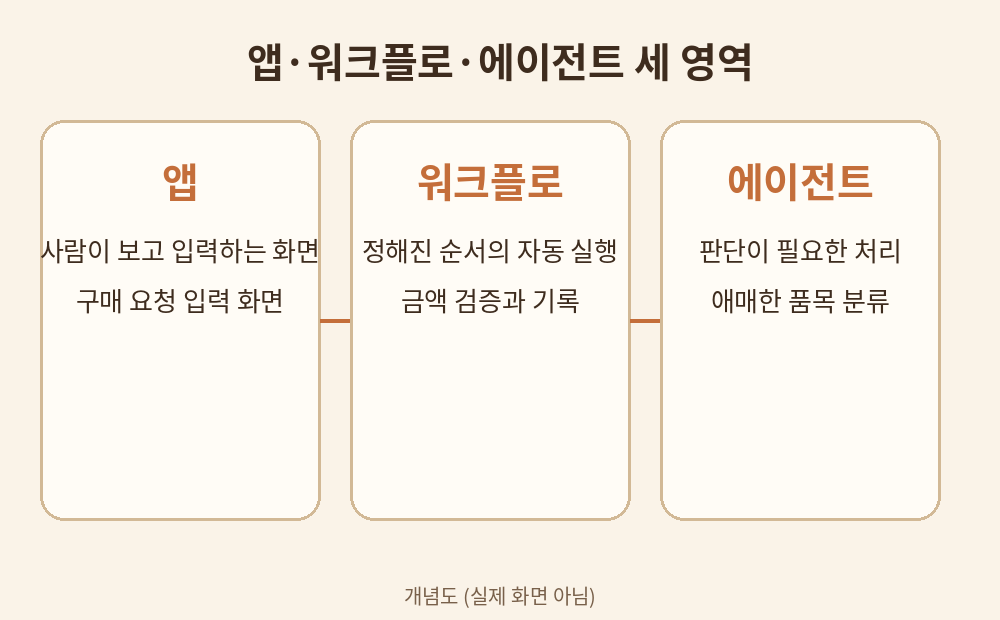

# 1장. 앱·워크플로·에이전트의 차이

## 학습 목표

1. 앱(화면), 워크플로(정해진 실행), 에이전트(판단)의 역할을 구분할 수 있다.
2. 하나의 업무를 세 영역으로 나누어 배치할 수 있다.
3. 미리보기와 정식 출시(GA)의 차이를 알고 기능 선택에 반영할 수 있다.

## 선행 개념

- 표: 행과 열로 정리된 데이터. 엑셀 시트를 떠올리면 된다.
- 조건문: 만약 금액이 50만원을 넘으면 승인자에게 보낸다 같은 규칙.
- 업무 절차: 누가, 언제, 무엇을 하는지의 순서.

## 쉬운 설명

Copilot Studio는 2026년 9월 업데이트부터 앱, 워크플로, 에이전트를 한 곳에서 만들 수 있게 되었다 [S1]. 세 가지는 같은 업무를 서로 다른 방식으로 처리한다.

앱은 사람이 보는 화면이다. 신청서를 입력하고, 진행 상태를 확인하고, 결과를 조회하는 창구다. 2026년 10월 현재 Apps는 공개 미리보기 상태다 [S1].

워크플로는 정해진 순서대로 실행되는 자동화다. 조건이 맞으면 다음 단계로 넘어가고, 틀리면 다른 길로 간다. 사람이 개입하지 않아도 매번 똑같이 동작한다. 에이전트 플로우(agent flows)라고도 부른다.

에이전트는 상황을 보고 판단하는 AI다. 정해진 답이 없을 때 자료를 찾아보고, 도구를 골라 실행하고, 결과를 설명한다. 애매한 요청을 분류하거나 예외를 처리할 때 쓴다.

정리하면 다음과 같다.

| 구분 | 역할 | 예 |
|------|------|-----|
| 앱 | 사람이 보고 입력하는 화면 | 구매 요청 입력 화면 |
| 워크플로 | 정해진 순서의 자동 실행 | 금액 검증과 기록 |
| 에이전트 | 판단이 필요한 처리 | 애매한 품목 분류 |

## 용어 풀이

- 미리보기(Preview): 정식 출시 전 공개된 기능. 사양이 바뀔 수 있다.
- GA(General Availability): 정식 출시. 기업이 실제 업무에 써도 되는 단계.
- 순차 배포: 지역과 테넌트마다 기능이 나타나는 시점이 다르다 [S2].
- 테넌트: 회사의 Microsoft 365 공간 단위.

## 가상 데이터 예시

이 책에서는 가상의 회사 두빛상사를 쓴다. 모든 이름과 금액은 가상의 것이다.

가상 구매 요청 1건:
- 요청자: 김가상 (가상 인물)
- 품목: 노트북 2대
- 금액: 3,200,000원
- 사유: 신규 입사자 지급

## 단계별 실습

실습 1. 가상 구매 요청 업무를 세 영역으로 나누기

1. 종이에 세 칸을 그린다. 칸 이름은 앱, 워크플로, 에이전트다.
2. 구매 요청 업무의 단계들을 하나씩 꺼내어 칸에 넣는다. 예: 요청서 작성은 앱, 금액 합계 검증은 워크플로, 품목 분류가 애매하면 에이전트.
3. 각 칸에 최소 2개씩 들어가도록 나눈다. 애매한 단계는 에이전트 칸에 둔다.
4. 나눈 결과를 아래 점검표로 확인한다.

## 복사용 프롬프트

구매 요청 업무를 앱 화면, 규칙형 워크플로, AI 판단이 필요한 예외 처리로 분해해줘.

## 예상 결과

앱 칸에는 입력·조회 화면이, 워크플로 칸에는 검증·기록·알림이, 에이전트 칸에는 분류·요약·예외 판단이 들어간다.

## 흔한 오류와 해결책

- 오류: 모든 단계를 에이전트에 맡긴다. 해결: 정해진 규칙은 워크플로로 옮긴다. 비용과 오류가 줄어든다.
- 오류: 미리보기 기능을 확정 기능처럼 안내한다. 해결: Apps는 공개 미리보기임을 표시한다 [S1].

## 자가 점검표

- [ ] 세 영역의 차이를 말로 설명할 수 있다
- [ ] 가상 구매 요청을 세 칸에 나누었다
- [ ] 미리보기와 GA를 구분하였다

## 계정 없는 독자를 위한 종이 설계 실습

위 실습 1을 그대로 종이에서 한다. Copilot Studio 계정이 없어도 세 영역 나누기는 종이와 펜으로 충분하다.

## 관련 공식 출처

- [S1] Microsoft, New and improved: Build apps, extend agents, and transform business processes in Microsoft Copilot Studio, 2026-10-07, https://www.microsoft.com/en-us/copilot/blog/copilot-studio/new-and-improved-build-apps-extend-agents-and-transform-business-processes-in-microsoft-copilot-studio/, 열람 2026-10-11
- [S2] Microsoft Learn, What's new in Copilot Studio, 갱신형 문서, https://learn.microsoft.com/en-us/microsoft-copilot-studio/whats-new, 열람 2026-10-11
