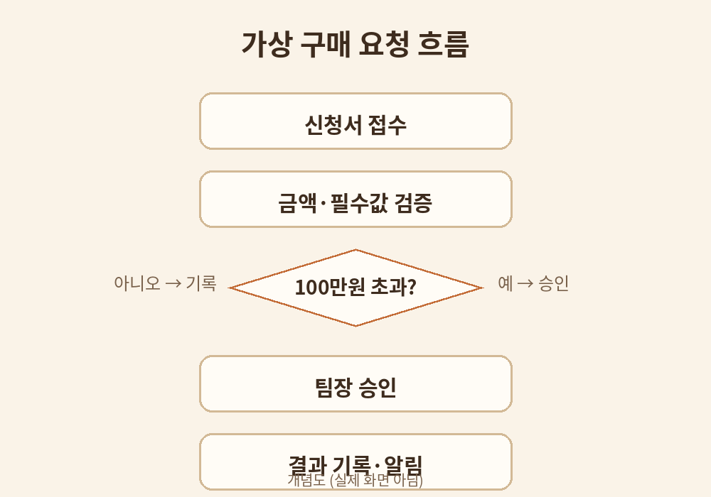

# 3장. 업무 절차를 도식화하기

## 학습 목표

1. 업무 절차를 트리거·액션·조건·승인자로 분해할 수 있다.
2. 가상 구매 신청의 흐름도를 그릴 수 있다.
3. 예외 처리를 흐름에 포함시킬 수 있다.

## 선행 개념

- 트리거: 흐름을 시작하는 사건. 예: 신청서가 접수되었다.
- 액션: 실행되는 동작. 예: 금액을 검증한다.
- 조건: 갈림길. 예: 금액이 100만원을 넘으면.
- 승인자: 확인하고 도장을 찍는 사람.

## 쉬운 설명

워크플로를 만들기 전에 먼저 종이 위에서 업무를 그린다. 도식화는 설계도다. 설계도 없이 만들면 나중에 고치기 어렵다.

구매 요청 업무를 예로 들어보자. 시작은 신청서 접수다. 다음은 금액 검증이다. 금액이 기준을 넘으면 승인자에게 간다. 기준 이하면 바로 기록한다. 승인이 떨어지면 결과를 알린다. 각 단계마다 누가, 무엇을, 언제 하는지가 적혀 있어야 한다.

흐름을 그릴 때는 다음 네 가지를 빠뜨리지 않는다.

1. 시작 조건 (트리거): 무엇이 흐름을 시작하는가
2. 검증 단계: 무엇을 확인하는가
3. 갈림길 (조건): 어디서 나뉘는가
4. 끝: 어디서 끝나는가, 기록은 남는가

## 용어 풀이

- 에이전트 플로우: Copilot Studio에서 만드는 자동화 흐름. 트리거와 액션으로 구성된다 [S3].
- 자연어 흐름 제작: 문장으로 설명하면 흐름의 초안을 만들어주는 기능 [S3].

## 가상 데이터 예시

가상의 두빛상사 구매 요청 흐름 (가상):

- 트리거: 구매 요청서 접수
- 검증: 금액 합계와 필수 항목 확인
- 조건: 100만원 초과이면 팀장 승인, 이하면 자동 기록
- 액션: 승인 요청 알림 발송, 결과 기록
- 예외: 필수 항목 누락이면 요청자에게 반송

## 단계별 실습

실습 1. 가상 구매 신청 흐름도 그리기

1. 종이에 시작 상자를 그리고 트리거를 적는다.
2. 검증 단계를 순서대로 상자로 잇는다.
3. 조건이 있는 곳에 마름모를 그리고 갈림길을 표시한다.
4. 각 갈림길의 끝을 적고, 기록이 남는 곳에 표시한다.
5. 아래 복사용 프롬프트로 AI에게 텍스트 흐름도를 요청하고 자신의 그림과 비교한다.

## 복사용 프롬프트

요청 접수→금액 검증→승인→기록 순서를 조건 분기와 예외 처리까지 포함한 텍스트 흐름도로 표현해줘.

## 예상 결과

시작부터 끝까지 끊기지 않는 흐름도가 나온다. 조건마다 두 갈래가 있고, 예외가 처리된다.

## 흔한 오류와 해결책

- 오류: 예외 처리를 빼먹는다. 해결: 누락·오류·거부 케이스를 각각 흐름에 넣는다.
- 오류: 승인자가 불분명하다. 해결: 각 승인 단계에 담당 역할을 적는다.

## 자가 점검표

- [ ] 흐름도에 트리거·액션·조건·승인자가 있다
- [ ] 예외 처리가 포함되었다
- [ ] AI 흐름도와 비교하였다

## 계정 없는 독자를 위한 종이 설계 실습

위 실습 1이 곧 종이 설계다. Copilot Studio 없이도 흐름도 그리기는 완전히 할 수 있다.

## 관련 공식 출처

- [S3] Microsoft Learn, Agent flows overview, 2026-08-03 업데이트, https://learn.microsoft.com/microsoft-copilot-studio/flows-overview, 열람 2026-10-11
- [S4] Microsoft Learn Training, Use agent flows in Copilot Studio, 상시 모듈, https://learn.microsoft.com/en-us/training/modules/use-agent-flows/, 열람 2026-10-11
