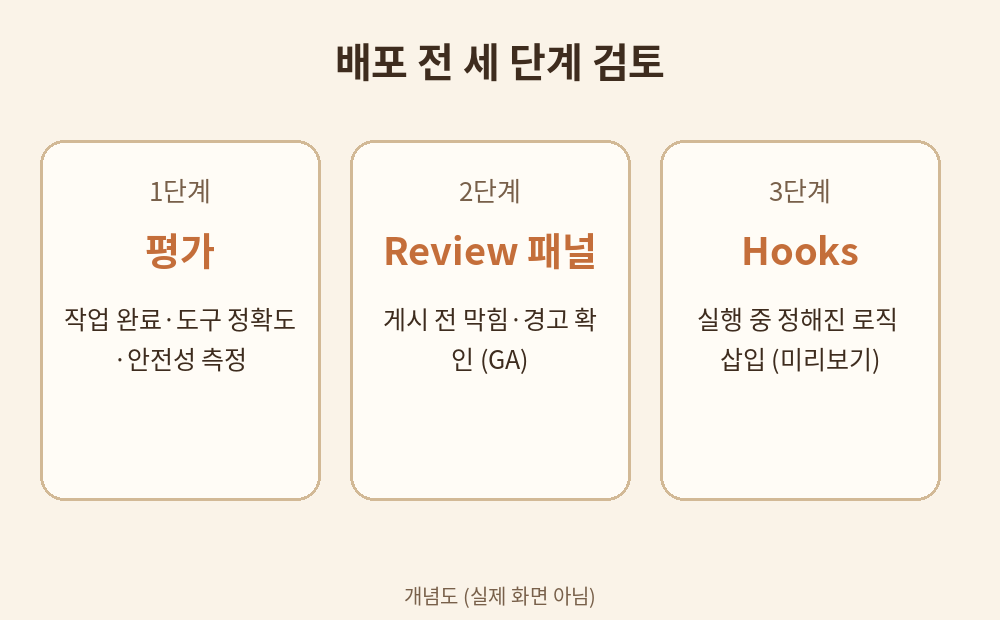

# 7장. 승인·평가·배포 전 검토

## 학습 목표

1. Hooks·평가·Review 패널의 역할을 이해한다.
2. 테스트 10건과 차단 조건을 만들 수 있다.
3. 배포 전 검토 항목을 점검표로 만들 수 있다.

## 선행 개념

- 평가: 정해진 테스트로 성능을 재는 일.
- 차단 조건: 이 경우엔 실행을 멈추는 규칙.
- 배포: 만든 것을 실제 업무에 내놓는 일.

## 쉬운 설명

만들었다고 바로 내놓으면 안 된다. 세 단계의 검토가 있다.

첫째, 평가다. Copilot Studio의 평가는 대화뿐 아니라 자동화까지 넓어졌다 [S1]. 작업 완료 여부, 도구 선택 정확도, 안전성, 응답 속도를 잰다. 사용자 정의 평가 기준도 만들 수 있다.

둘째, Review 패널이다. 게시 전에 막히는 점과 경고를 보여준다. 심각도 순으로 정리되고, 해결 방법도 안내한다. 2026년 10월 현재 정식 출시(GA) 상태다 [S1].

셋째, Hooks다. 실행 중 특정 시점에 정해진 로직을 끼워 넣어 예측 가능성을 높인다 [S1]. 미리보기 상태다.

테스트 케이스는 정상과 비정상을 섞어 10건을 만든다. 정상 4건, 누락 2건, 고액 1건, 중복 1건, 민감정보 1건, 애매 1건이 한 예다. 각 케이스마다 기대 결과와 차단 조건을 적는다.

## 용어 풀이

- Custom Graders Library: 평가 기준을 재사용하는 모음 [S1].
- Evaluation Viewer: 평가 결과만 볼 수 있는 역할 [S1].

## 가상 데이터 예시

가상의 테스트 10건 중 3건 (가상):

1. 정상: REQ-001 노트북 2대 3,200,000원 → 승인 요청 발송
2. 누락: REQ-003 수량 비어 있음 → 보류, 사유 기록
3. 고액: REQ-005 50,000,000원 → 임원 승인으로 상향

## 단계별 실습

실습 1. 테스트 10건과 차단 조건 만들기

1. 정상 케이스 4건을 적는다.
2. 비정상 케이스 6건을 적는다 (누락·고액·중복·민감정보·애매·형식 오류).
3. 각 케이스에 기대 결과와 차단 조건을 적는다.
4. 아래 복사용 프롬프트로 AI에게 10건을 요청하고 자신의 것과 비교한다.

## 복사용 프롬프트

정상/누락/고액/중복/민감정보 사례 10개를 만들고 승인 필요 조건과 실패 판정 기준을 써줘.

## 예상 결과

10건의 테스트 케이스와 각각의 기대 결과·차단 조건이 나온다.

## 흔한 오류와 해결책

- 오류: 정상 케이스만 테스트한다. 해결: 비정상을 절반 이상 넣는다.
- 오류: 평가를 한 번만 한다. 해결: 고치고 나서 다시 평가한다.

## 자가 점검표

- [ ] 테스트 10건이 있다
- [ ] 차단 조건이 명시되었다
- [ ] 평가·Review·Hooks를 설명할 수 있다

## 계정 없는 독자를 위한 종이 설계 실습

위 실습 1을 종이에서 한다. 테스트 케이스는 손으로 적는 표가 가장 좋다.

## 관련 공식 출처

- [S1] Microsoft, New and improved: Build apps, extend agents, and transform business processes in Microsoft Copilot Studio, 2026-10-07, https://www.microsoft.com/en-us/copilot/blog/copilot-studio/new-and-improved-build-apps-extend-agents-and-transform-business-processes-in-microsoft-copilot-studio/, 열람 2026-10-11
